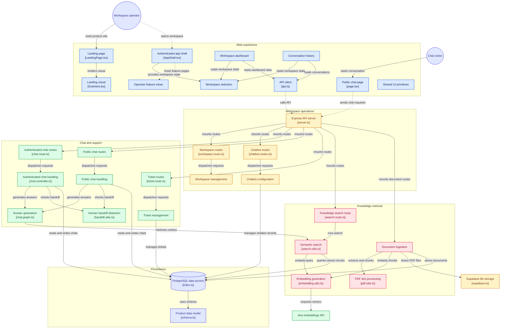
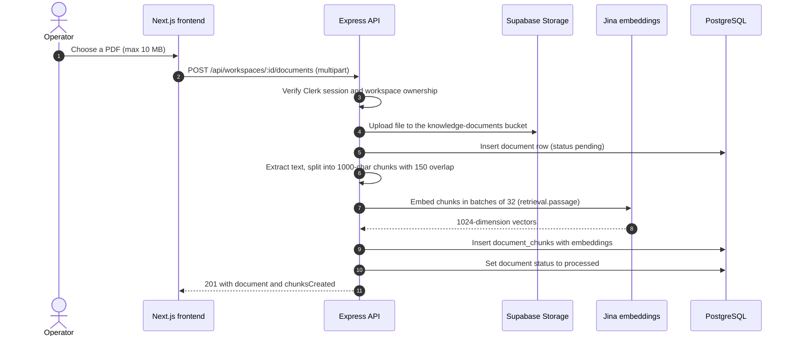
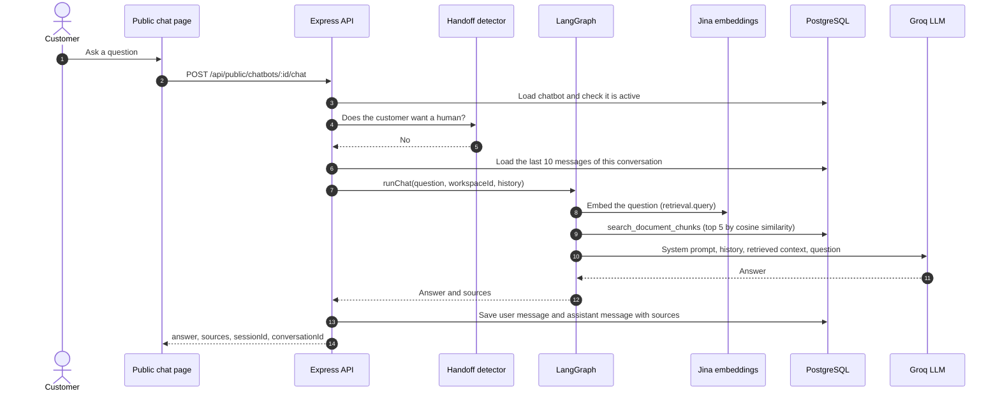
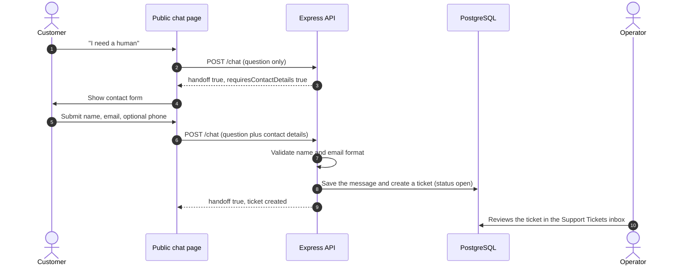
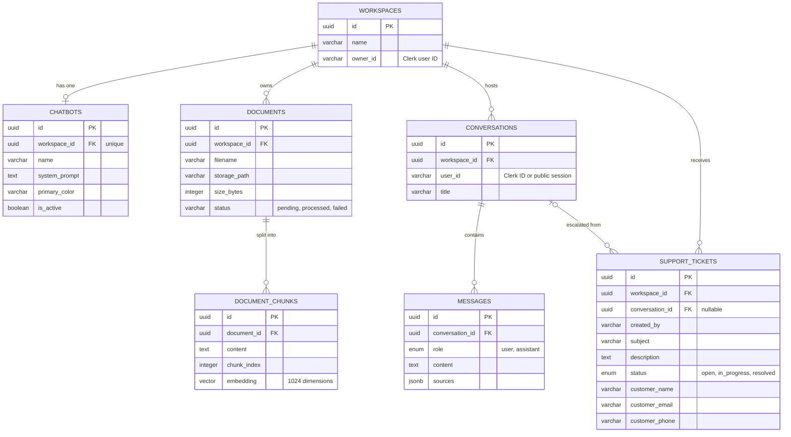

<div align="center">

# Converso

**AI customer support, trained on your own documents.**

Upload your PDFs, get a chatbot that answers from them with cited sources, and hand off to a human the moment a customer asks for one.


[Live app](https://theconverso.vercel.app) · [Architecture](#architecture) · [Getting started](#getting-started) · [API reference](#api-reference) · [Roadmap](#status-and-roadmap)

</div>

---

## Table of contents

1. [Overview](#overview)
2. [Features](#features)
3. [Architecture](#architecture)
4. [How it works](#how-it-works)
5. [Tech stack](#tech-stack)
6. [Project structure](#project-structure)
7. [Getting started](#getting-started)
8. [Environment variables](#environment-variables)
9. [API reference](#api-reference)
10. [Data model](#data-model)
11. [Security model](#security-model)
12. [Deployment](#deployment)
13. [Design system](#design-system)
14. [Status and roadmap](#status-and-roadmap)
15. [Author](#author)

---

## Overview

Converso is a customer-support platform for businesses. An operator signs in, creates a **workspace**, uploads company PDFs (policies, FAQs, product guides) and configures a **chatbot**. Customers then talk to that chatbot on a public link. Answers are generated with **retrieval-augmented generation (RAG)**: the question is matched against the operator's own documents, and the model answers only from what it finds, citing the source files. When a customer asks for a person, Converso collects their contact details and opens a **support ticket** in the operator's inbox.

**The problem it solves:** most support questions are already answered somewhere in a company's documents. Converso turns those documents into an assistant that resolves the routine questions instantly and routes everything else to humans with full context.

---

## Features

**For operators (authenticated dashboard)**

- **Workspaces:** create, rename, switch, and delete workspaces. Each workspace is isolated and has its own chatbot, documents, conversations, and tickets.
- **Chatbot configuration:** name, system prompt, brand color, and an active/inactive switch, with a live preview of the chat header.
- **Knowledge base:** upload PDFs (up to 10 MB each). Text is extracted, chunked, embedded, and stored for semantic search. A search box lets you test retrieval directly.
- **AI playground:** chat with your bot from the dashboard before sharing it, with source citations shown per answer.
- **Support ticket inbox:** tickets created by human-handoff requests, with customer name, email, and phone, a status filter, and `open` / `in_progress` / `resolved` workflow.
- **Dashboard overview:** chatbot status, open tickets, total tickets, and knowledge scope at a glance.
- **Light and dark themes**, persisted per browser.

**For customers (public chat page)**

- **Shareable link:** every chatbot gets a public page at `/chat/<chatbotId>`, copyable from the chatbot settings. No account required.
- **Cited answers:** each response lists the source documents it was based on.
- **Conversation memory:** the last 10 messages of a session are sent with each question so follow-ups make sense.
- **Human handoff:** phrases like "I need a human" trigger a contact form (name and email required, phone optional) and create a ticket.
- **Brand color:** the chat page uses the chatbot's configured primary color.

---

## Architecture

The diagram below shows the whole system: the Next.js frontend, the Express API, the RAG pipeline, and the external services (Postgres, Supabase Storage, Jina).



<sub>Diagram generated with [GitDiagram](https://gitdiagram.com/chinmaye5/converso).</sub>

### Responsibilities at a glance

| Layer | What it does | Where it lives |
| --- | --- | --- |
| **Frontend** | Landing page, authenticated dashboard, public chat page. Talks to the API with a Clerk bearer token. | `frontend/` (Next.js App Router) |
| **API** | Express 5 server. Verifies the Clerk session, checks workspace ownership, and dispatches to controllers. | `backend/server.ts`, `routes/`, `controllers/` |
| **RAG pipeline** | A two-node LangGraph graph (`retrieve` then `generate`) that answers questions from retrieved chunks. | `backend/ai/chat.graph.ts` |
| **Ingestion** | PDF extraction, chunking, batch embedding, and storage. | `backend/controllers/document.controller.ts`, `backend/utils/` |
| **Data** | PostgreSQL with pgvector, accessed through Drizzle ORM. PDFs live in Supabase Storage. | `backend/db/`, `backend/drizzle/` |

---

## How it works

### 1. Ingesting a document

Upload runs synchronously inside one request: when the API responds, the document is either `processed` or `failed`.



If text extraction or embedding fails, the document is marked `failed` and the API returns `201` with a `warning`. If the database insert fails after the upload, the stored file is removed so no orphan is left.

### 2. Answering a question (RAG)



Design choices worth knowing:

- **Grounded answers:** the model is instructed to treat document content as the source of truth, to say it doesn't know when the documents lack the answer, and to treat document text as untrusted data rather than instructions.
- **No context, no model call:** if retrieval returns zero chunks, the API replies with a fixed "contact the support team" message instead of calling the LLM.
- **Deterministic output:** the model runs at `temperature: 0`.

### 3. Human handoff



Handoff detection is a set of regular expressions in `backend/ai/handoff.utils.ts` that match phrases such as "speak to a human", "talk to an agent", "real person", and "customer service".

---

## Tech stack

| Area | Technology |
| --- | --- |
| **Frontend framework** | Next.js 16 (App Router, Turbopack), React 19, TypeScript |
| **Styling** | Tailwind CSS 4, CSS-variable theming (light and dark), Inter and JetBrains Mono, Lucide icons |
| **Landing visual** | `Grainient` WebGL shader background from [React Bits](https://reactbits.dev) |
| **Frontend data** | Axios API client, React context for workspace and theme, `react-markdown` with `remark-gfm` |
| **Authentication** | [Clerk](https://clerk.com) (`@clerk/nextjs` on the frontend, `@clerk/express` on the API) |
| **API runtime** | [Bun](https://bun.sh) and Express 5 |
| **Database** | PostgreSQL (Supabase) with the pgvector extension |
| **ORM and migrations** | Drizzle ORM and Drizzle Kit, using the `postgres` driver |
| **File storage** | Supabase Storage (`knowledge-documents` bucket) |
| **Embeddings** | Jina AI, model `jina-embeddings-v5-text-small` (1024 dimensions) |
| **LLM** | Groq via `@langchain/groq`, default model `openai/gpt-oss-120b` (configurable) |
| **Orchestration** | LangGraph (`@langchain/langgraph`) |
| **PDF parsing** | `pdf-parse` |
| **Uploads** | Multer (in-memory, PDF only, 10 MB limit) |
| **Hosting** | Vercel (frontend), Render (API) |

---

## Project structure

```text
converso/
├── backend/
│   ├── server.ts                 # Express app: CORS, Clerk middleware, route mounting
│   ├── ai/
│   │   ├── chat.graph.ts         # LangGraph RAG graph (retrieve -> generate)
│   │   └── handoff.utils.ts      # "I want a human" detection
│   ├── controllers/              # Request handlers
│   │   ├── workspace.controller.ts
│   │   ├── chatbot.controller.ts
│   │   ├── document.controller.ts    # Upload, extract, chunk, embed, store
│   │   ├── chat.controller.ts        # Authenticated chat (playground)
│   │   ├── public-chat.controller.ts # Anonymous customer chat and handoff
│   │   ├── ticket.controller.ts
│   │   ├── profile.controller.ts
│   │   └── health.controller.ts
│   ├── routes/                   # Express routers, one per resource
│   ├── utils/
│   │   ├── pdf.utils.ts          # Text extraction and chunking
│   │   ├── embedding.utils.ts    # Jina client with batching
│   │   └── search.utils.ts       # Vector search through search_document_chunks()
│   ├── db/
│   │   ├── schema.ts             # Drizzle schema (source of truth)
│   │   ├── index.ts              # Postgres connection
│   │   └── supabase.ts           # Supabase Storage client
│   ├── drizzle/                  # Generated SQL migrations 0000-0008
│   └── drizzle.config.ts
└── frontend/
    ├── middleware.ts             # Clerk route protection and public-route list
    ├── app/
    │   ├── page.tsx              # Landing page
    │   ├── login/ signup/        # Clerk sign-in and sign-up
    │   ├── dashboard/ chatbot/ knowledge-base/
    │   ├── tickets/ playground/ conversations/
    │   ├── settings/ profile/ logout/
    │   └── chat/[chatbotId]/     # Public customer chat page
    ├── components/
    │   ├── landing/              # LandingPage
    │   ├── Grainient.tsx         # WebGL gradient background
    │   ├── layout/               # AppShell, AppSidebar, AppHeader
    │   ├── dashboard/ chatbot/ documents/ tickets/
    │   ├── playground/ conversations/ settings/
    │   └── ui/                   # StatCard, StatusBadge, EmptyState, ...
    └── lib/
        ├── api.ts                # Typed API client (Axios)
        ├── types.ts
        ├── workspace-context.tsx # Current workspace, persisted in localStorage
        └── theme-context.tsx     # Light and dark theme
```

---

## Getting started

### Prerequisites

- [Bun](https://bun.sh) 1.4 or later
- Node.js 20 or later (required by Next.js)
- Accounts and keys for:
  - **[Clerk](https://clerk.com):** an application with publishable and secret keys
  - **[Supabase](https://supabase.com):** a project with Postgres and Storage
  - **[Groq](https://console.groq.com):** an API key
  - **[Jina AI](https://jina.ai):** an API key for embeddings

### 1. Clone and install

```bash
git clone https://github.com/chinmaye5/converso.git
cd converso

cd backend && bun install
cd ../frontend && bun install
```

### 2. Prepare Supabase

Run these once in the Supabase SQL editor, then create the storage bucket.

**a) Enable pgvector**

```sql
create extension if not exists vector with schema extensions;
```

**b) Create the tables.** From `backend/`, with `DATABASE_URL` set (see [Environment variables](#environment-variables)):

```bash
bun run db:migrate
```

**c) Create the vector search function.** The API calls a Postgres function named `search_document_chunks`, which is **not** part of the Drizzle migrations, so you must create it yourself. This is a reference implementation matching the signature and return columns the code expects:

```sql
create or replace function search_document_chunks(
  query_embedding extensions.vector(1024),
  match_workspace_id uuid,
  match_count integer default 5
)
returns table (
  chunk_id uuid,
  document_id uuid,
  filename text,
  content text,
  similarity double precision
)
language sql
stable
as $$
  select
    dc.id            as chunk_id,
    dc.document_id   as document_id,
    d.filename::text as filename,
    dc.content       as content,
    1 - (dc.embedding <=> query_embedding) as similarity
  from document_chunks dc
  join documents d on d.id = dc.document_id
  where d.workspace_id = match_workspace_id
    and dc.embedding is not null
  order by dc.embedding <=> query_embedding
  limit match_count;
$$;
```

Optionally add an index once you have a lot of chunks:

```sql
create index if not exists document_chunks_embedding_idx
  on document_chunks using hnsw (embedding vector_cosine_ops);
```

**d) Create the storage bucket.** In Supabase, go to **Storage**, then create a **private** bucket named exactly `knowledge-documents`.

### 3. Configure environment variables

Create `backend/.env` and `frontend/.env.local` using the values in the [next section](#environment-variables).

### 4. Run it

Use two terminals:

```bash
# Terminal 1: API on http://localhost:5000
cd backend
bun run dev

# Terminal 2: web app on http://localhost:3000
cd frontend
bun dev
```

Check the API at <http://localhost:5000/health>, then open <http://localhost:3000>.

### 5. First-run walkthrough

1. **Sign up** from the landing page.
2. **Create a workspace** (you are prompted on first login).
3. Open **Chatbot**, create the chatbot, set its name, prompt, and color.
4. Open **Knowledge Base** and upload one or more PDFs. Wait for the status to show `processed`.
5. Open **AI Playground** and ask a question your PDFs can answer. Check the cited sources.
6. Back in **Chatbot**, copy the **public link** (`/chat/<chatbotId>`) and open it in a private window to chat as a customer.
7. Type "I need a human" in the public chat, submit the form, and find the ticket under **Support Tickets**.

---

## Environment variables

### Backend (`backend/.env`)

| Variable | Required | Description |
| --- | --- | --- |
| `DATABASE_URL` | Yes | Postgres connection string from Supabase (direct or session-pooler). SSL is always required. |
| `SUPABASE_URL` | Yes | Your Supabase project URL. |
| `SUPABASE_SERVICE_ROLE_KEY` | Yes | Service-role key used server-side for Storage. **Never expose it to the browser.** |
| `CLERK_SECRET_KEY` | Yes | Clerk secret key, read automatically by `@clerk/express`. |
| `CLERK_PUBLISHABLE_KEY` | Yes | Clerk publishable key, read automatically by `@clerk/express`. |
| `GROQ_API_KEY` | Yes | Groq API key. The server refuses to start without it. |
| `JINA_API_KEY` | Yes | Jina API key used for embeddings. |
| `GROQ_MODEL` | No | Groq model name. Defaults to `openai/gpt-oss-120b`. |
| `PORT` | No | Port to listen on. Defaults to `5000`. Render sets this for you. |

### Frontend (`frontend/.env.local`)

| Variable | Required | Description |
| --- | --- | --- |
| `NEXT_PUBLIC_CLERK_PUBLISHABLE_KEY` | Yes | Clerk publishable key. |
| `CLERK_SECRET_KEY` | Yes | Clerk secret key (used by the middleware). |
| `NEXT_PUBLIC_CLERK_SIGN_IN_URL` | Recommended | Set to `/login` so redirects use your sign-in page. |
| `NEXT_PUBLIC_CLERK_SIGN_UP_URL` | Recommended | Set to `/signup`. |
| `NEXT_PUBLIC_API_URL` | Yes in production | Base URL of the API. Defaults to `http://localhost:5000`. |

> `NEXT_PUBLIC_` values are inlined at build time, so redeploy the frontend after changing them.

---

## API reference

All `/api/workspaces/**` and `/api/profile` routes require a Clerk session: send `Authorization: Bearer <Clerk session token>`. Every workspace-scoped route also verifies that the signed-in user owns the workspace and returns `404` otherwise. The `/api/public/**` routes need no authentication.

### Health and profile

| Method | Path | Description |
| --- | --- | --- |
| `GET` | `/health` | Liveness check. |
| `GET` | `/api/profile` | Name and email of the signed-in user, from Clerk. |

### Workspaces

| Method | Path | Body | Description |
| --- | --- | --- | --- |
| `POST` | `/api/workspaces` | `{ name }` | Create a workspace. |
| `GET` | `/api/workspaces` | | List the user's workspaces. |
| `GET` | `/api/workspaces/:id` | | Get one workspace. |
| `PATCH` | `/api/workspaces/:id` | `{ name }` | Rename a workspace. |
| `DELETE` | `/api/workspaces/:id` | | Delete a workspace and, by cascade, its data. |

### Chatbot (one per workspace)

| Method | Path | Body | Description |
| --- | --- | --- | --- |
| `POST` | `/api/workspaces/:workspaceId/chatbot` | `{ name? }` | Create the workspace's chatbot. |
| `GET` | `/api/workspaces/:workspaceId/chatbot` | | Get it (`404` if none yet). |
| `PATCH` | `/api/workspaces/:workspaceId/chatbot` | `{ name?, systemPrompt?, primaryColor?, isActive? }` | Update settings. |
| `DELETE` | `/api/workspaces/:workspaceId/chatbot` | | Delete it. |

### Knowledge base

| Method | Path | Body | Description |
| --- | --- | --- | --- |
| `POST` | `/api/workspaces/:workspaceId/documents` | `multipart/form-data`, field `file` (PDF, max 10 MB) | Upload, extract, chunk, embed, and store a PDF. Returns `{ document, chunksCreated }`. |
| `POST` | `/api/workspaces/:workspaceId/search` | `{ question, limit? }` | Semantic search over the workspace's chunks. Returns `{ results }` (default `limit` is 5). |

### Chat (authenticated playground)

| Method | Path | Body | Description |
| --- | --- | --- | --- |
| `POST` | `/api/workspaces/:workspaceId/chat` | `{ question, conversationId? }` | Ask the bot. Returns `{ conversationId, answer, sources }`, or `{ handoff: true, ticket }` if the user asked for a human. |

### Tickets

| Method | Path | Body | Description |
| --- | --- | --- | --- |
| `POST` | `/api/workspaces/:workspaceId/tickets` | `{ subject, description, conversationId? }` | Create a ticket manually. |
| `GET` | `/api/workspaces/:workspaceId/tickets` | | List tickets. |
| `PATCH` | `/api/workspaces/:workspaceId/tickets/:ticketId/status` | `{ status }` | Set status to `open`, `in_progress`, or `resolved`. |

### Public chat (no authentication)

| Method | Path | Body | Description |
| --- | --- | --- | --- |
| `GET` | `/api/public/chatbots/:chatbotId/info` | | Returns `{ chatbot: { id, name, primaryColor, isActive } }`. |
| `POST` | `/api/public/chatbots/:chatbotId/chat` | `{ question, sessionId?, conversationId?, customerName?, customerEmail?, customerPhone? }` | Ask the bot. See the responses below. |

**Public chat responses**

```jsonc
// Normal answer
{ "sessionId": "…", "conversationId": "…", "answer": "…", "sources": [{ "filename": "…", "content": "…", "similarity": 0.82 }] }

// Customer asked for a human, contact details still needed
{ "sessionId": "…", "conversationId": "…", "handoff": true, "requiresContactDetails": true, "message": "…" }

// Details supplied, ticket created
{ "handoff": true, "requiresContactDetails": false, "ticket": { "id": "…", "status": "open", "customerName": "…", "customerEmail": "…" } }
```

Send back the `sessionId` and `conversationId` you receive on every follow-up request to keep the conversation going.

---

## Data model



- **Cascades:** deleting a workspace removes its chatbot, documents, chunks, conversations, messages, and tickets. Deleting a conversation sets `conversation_id` to null on its tickets.
- **Anonymous customers:** public conversations store `user_id` as `public:<chatbotId>:<sessionId>`, so a visitor can only resume their own conversation.
- **Schema changes:** edit `backend/db/schema.ts`, run `bun run db:generate`, then `bun run db:migrate`.

---

## Security model

- **Authentication:** Clerk verifies sessions. The API calls `clerkMiddleware()` and each protected controller reads the user with `getAuth(req)`.
- **Authorization:** every workspace-scoped query is filtered by `ownerId = <signed-in user>`, so one operator cannot read or modify another's workspace. A foreign or unknown workspace returns `404`, not `403`.
- **Route protection (frontend):** `frontend/middleware.ts` protects every route except `/`, `/chat/*`, `/login*`, and `/signup*`.
- **Public surface is minimal:** the public endpoints expose only a chatbot's id, name, color, and active flag, and only answer when the chatbot is active. Session IDs must be valid UUIDs.
- **Prompt-injection hardening:** the system prompt tells the model to treat retrieved document text as data, not instructions.
- **Uploads:** PDF only (by extension), 10 MB cap, held in memory, filenames sanitised, and stored under a per-workspace path in a private bucket.
- **Secrets:** the Supabase service-role key and all API keys are server-side only. `.env` files are git-ignored.
- **CORS:** the API accepts requests only from an explicit allow-list in `backend/server.ts`.

---

## Deployment

Converso is deployed as two independent services.

### Frontend on Vercel

1. Import the repository and set **Root Directory** to `frontend`.
2. Add the [frontend environment variables](#frontend-frontendenvlocal). Point `NEXT_PUBLIC_API_URL` at your deployed API.
3. Deploy. Redeploy whenever you change a `NEXT_PUBLIC_` variable.

### API on Render

| Setting | Value |
| --- | --- |
| **Root Directory** | `backend` |
| **Build Command** | `bun install` |
| **Start Command** | `bun server.ts` |
| **Environment** | All [backend variables](#backend-backendenv) |

### Connect the two

Add your frontend's public URL to the `origin` array in `backend/server.ts`, or browser requests to the API will be blocked by CORS:

```ts
app.use(cors({
  origin: ['http://localhost:3000', 'https://your-frontend.vercel.app'],
}));
```

If you see `MIDDLEWARE_INVOCATION_FAILED` on Vercel, the Clerk environment variables are missing from the project. If the API crashes at start with `Cannot find module 'dotenv/config'`, run `bun add dotenv` in `backend/` and commit both `package.json` and `bun.lock`.

---

## Design system

The interface follows a **Swiss Modernism** direction: a strict grid, flat surfaces, hairline borders, square corners (1 to 2 px radius), and a single red accent.

- **Color tokens:** CSS variables in `frontend/app/globals.css` for surfaces, borders, text, and accent, defined once for light and once for dark (`data-theme`).
- **Accent:** `#E30613`.
- **Type:** Inter for text, JetBrains Mono for small data labels.
- **Landing hero:** a `Grainient` WebGL gradient in dark-to-red tones behind the headline.

---

## Status and roadmap

What exists today, and what is honestly still to do.

| Area | Status | Notes |
| --- | --- | --- |
| Auth, workspaces, chatbot settings | Done | |
| PDF ingestion and semantic search | Done | Ingestion is synchronous. |
| RAG answers with cited sources | Done | |
| Public chat page and shareable link | Done | |
| Human handoff and ticket inbox | Done | |
| Document list and delete | Not yet | Only upload exists. The `DELETE` endpoint and Storage cleanup are missing. |
| Conversation history in the dashboard | Not yet | Messages are saved to the database, but there are no list or read endpoints. The Conversations page keeps sessions in the browser only. |
| Public chat page branding from the API | Not yet | The page uses default name and color. `GET /api/public/chatbots/:id/info` already exists, so it only needs to be wired up. |
| Embeddable website widget | Not yet | Today you share a link. A one-line script embed is planned. |
| Plans, billing, usage limits | Not yet | The landing-page pricing is presentational. Nothing is enforced or charged. |
| Analytics dashboard | Partial | Overview cards only. No resolution-rate or volume charts yet. |
| Rate limiting on public endpoints | Not yet | Recommended before wide public use. |
| Cleanup on workspace delete | Not yet | Database rows cascade, but uploaded PDFs remain in Storage. |
| Automated tests, CI | Not yet | |
| `.env.example` files, license | Not yet | |

Contributions and suggestions are welcome. Open an issue to discuss a change before sending a large pull request.

---

## Author

Built by **Chinmaye** ([@chinmaye5](https://github.com/chinmaye5)).